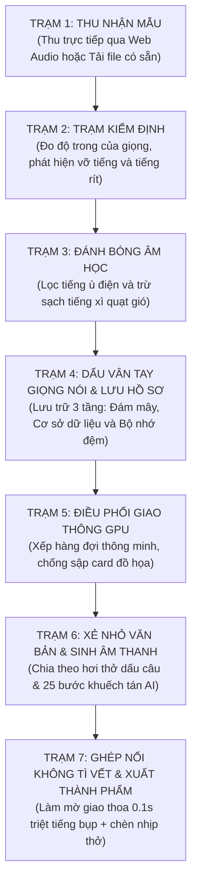
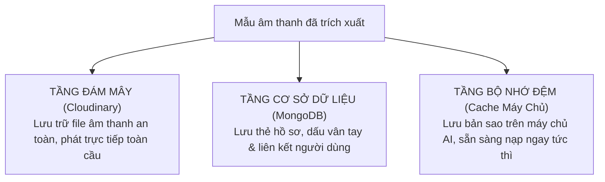

# BỘ TÀI LIỆU THUYẾT TRÌNH 15 SLIDES: QUY TRÌNH TOÀN DIỆN HỆ THỐNG AI VOICE STUDIO
> **Mục đích tài liệu:** Tài liệu được chia nhỏ chuẩn xác 1:1 theo từng Slide PowerPoint (Slide 1 đến Slide 15), sử dụng văn phong tự nhiên, không chứa code, kèm sơ đồ trực quan và lời thoại thuyết trình (Speaker Notes) chi tiết để bạn có thể đọc thuyết trình ngay hoặc đưa vào các công cụ AI chuyên tạo slide (Gamma, Tome, SlidesAI, ChatGPT).

---

## SLIDE 1: TRANG BÌA (TITLE SLIDE)
- **Danh mục:** BÁO CÁO ĐỒ ÁN CHUYÊN ĐỀ & THẨM ĐỊNH KỸ THUẬT THỰC CHIẾN
- **Tiêu đề lớn:** THẨM ĐỊNH KỸ THUẬT & KIẾN TRÚC TOÀN DIỆN HỆ THỐNG AI VOICE STUDIO
- **Tiêu đề phụ:** Phân tích luồng xử lý âm học từ thu âm đến xuất bản và kiểm định theo thang điểm 10 chuẩn Senior Tech Lead

### 3 Thẻ Tóm Tắt Nhanh:
1. **Công nghệ cốt lõi:**
   - Mô hình khuếch tán âm thanh tiên tiến kết hợp bộ tái tạo sóng âm thế hệ mới.
   - Nhân bản giọng nói tức thì (Zero-Shot) từ mẫu âm thanh siêu ngắn 5 - 15 giây.
   - Phân đoạn văn bản dài thông minh và ghép nối âm thanh không tì vết.
2. **Quản trị hạ tầng:**
   - Trạm điều phối hàng đợi thông minh bảo vệ card đồ họa chống sập.
   - Kiểm soát luồng chạy song song an toàn, không gây nghẽn phần cứng.
   - Bắn thông báo tiến độ trực tiếp về trình duyệt người dùng theo thời gian thực.
3. **Đánh giá thực tế:**
   - Điểm tổng kết thẩm định: **7.6 / 10** (Xếp loại: Vững chắc - Solid Architecture).
   - Vạch trần điểm nghẽn tích tụ rác bộ nhớ đồ họa và nguy cơ quá tải đa tiến trình.
   - Bản lộ trình 3 giai đoạn để nâng cấp hệ thống đạt chuẩn xuất sắc (9.5 / 10).

> 🎙️ **Lời thoại thuyết trình (Speaker Note):**  
> *"Kính thưa Thầy Cô và các bạn, hôm nay nhóm em xin trình bày về hệ thống AI Voice Studio - giải pháp lồng tiếng tự động cho nền tảng sản xuất video ngắn. Thay vì chỉ nói về tính năng trên lý thuyết, bài thuyết trình được thiết kế theo góc nhìn phản biện nghiêm ngặt của một Senior Tech Lead khó tính: mổ xẻ cặn kẽ từng khâu kỹ thuật từ micro đến tai người nghe, phân tích trần giới hạn phần cứng và chỉ ra các thiếu sót thực tế cần hoàn thiện trước khi thương mại hóa."*

---

## SLIDE 2: BÀI TOÁN THỰC TẾ & 4 TRỤ CỘT CỦA AI VOICE STUDIO
- **Danh mục:** TỔNG QUAN NGHIỆP VỤ
- **Tiêu đề:** BÀI TOÁN THỰC TẾ TRONG SẢN XUẤT VIDEO & 4 TRỤ CỘT TÍNH NĂNG
- **Ảnh chụp giao diện thực tế:** [01_voice_studio_main.png](screenshots/voice_studio/01_voice_studio_main.png) (Màn hình trung tâm hiển thị các tab Tạo Giọng, Thu Âm & Huấn Luyện, và Kho Giọng Đã Lưu)

### Cột 1: 4 Nút Thắt Của Cách Làm Truyền Thống
1. **Chi phí đắt đỏ:** Thuê người lồng tiếng chuyên nghiệp tốn từ 20 đến 50 USD cho một video ngắn.
2. **Thời gian chờ đợi quá lâu:** Mất từ 24 đến 48 giờ để nhận bản thu và duyệt sửa âm thanh.
3. **Khó khăn khi làm video hàng loạt:** Kênh TikTok/Shorts tự động cần 10 - 30 video mỗi ngày, nhân lực thủ công không thể đáp ứng.
4. **Kịch bản dài bị méo tiếng:** Các công nghệ đọc cũ khi đọc bài văn 3.000 - 5.000 từ thường bị nghẹt mũi, vấp từ và phát ra tiếng robot.

### Cột 2: 4 Trụ Cột Vũ Khí Của AI Voice Studio
1. **Nhân bản giọng nói tức thì (Zero-Shot Voice Cloning):** Bắt chước chuẩn xác bất kỳ giọng nói nào chỉ sau 5 - 15 giây âm thanh mẫu.
2. **Thiết kế mẫu giọng độc quyền (Voice Design):** Khởi tạo chất giọng mới hoàn toàn theo mô tả (giới tính, tuổi tác, phong cách truyền cảm).
3. **Xử lý kịch bản dài (Long Audio Pipeline):** Tự động ngắt nghỉ theo hơi thở và ghép nối phẳng lì không để lại tiếng bụp.
4. **Phòng thu ảo trên trình duyệt (Web Voice Booth):** Đo lường độ trong của âm thanh trực tiếp và tạo hồ sơ dùng vĩnh viễn.

> 🎙️ **Lời thoại thuyết trình (Speaker Note):**  
> *"Nút thắt lớn nhất của việc sáng tạo nội dung tự động chính là khâu lồng tiếng. AI Voice Studio ra đời giúp giảm 95% chi phí và rút ngắn thời gian sản xuất từ 2 ngày xuống chỉ còn vài giây, mở ra kỷ nguyên sản xuất video hàng loạt không giới hạn."*

---

## SLIDE 3: BẢN ĐỒ HÀNH TRÌNH TỔNG THỂ (7 TRẠM LIÊN HOÀN)
- **Danh mục:** KIẾN TRÚC TỔNG THỂ
- **Tiêu đề:** BẢN ĐỒ HÀNH TRÌNH TỪ MICRO ĐẾN BẢN ĐỌC HOÀN CHỈNH

> 🎙️ **Lời thoại thuyết trình (Speaker Note):**  
> *"Một file âm thanh khi người dùng tải lên hay thu âm sẽ không đi thẳng vào mô hình AI ngay, mà bắt buộc phải băng qua 7 trạm kiểm soát nghiêm ngặt. Trạm 1 đến 4 chịu trách nhiệm xây dựng 'dấu vân tay giọng nói'. Trạm 5 đến 7 chịu trách nhiệm sản xuất và biến một bài báo dài thành một bản audio hoàn chỉnh."*

---

## SLIDE 4: TRẠM 1 - THU NHẬN MẪU (THU TRỰC TIẾP & TẢI FILE CÓ SẴN)
- **Danh mục:** TRẠM 1 / 7
- **Tiêu đề:** THU NHẬN MẪU GIỌNG: LINH HOẠT VỚI 2 PHƯƠNG THỨC ĐẦU VÀO
- **Ảnh chụp giao diện thực tế:** [03_voice_record.png](screenshots/voice_studio/03_voice_record.png) & [03_voice_training.png](screenshots/voice_studio/03_voice_training.png) (Giao diện Thu Âm & Huấn Luyện)

### Phương Thức A: Thu Âm Trực Tiếp Tại Phòng Thu Ảo
- Người dùng bấm micro trực tiếp ngay trên trình duyệt web.
- Được cung cấp sẵn 30 câu đọc mẫu chuẩn âm vị tiếng Việt (đủ 6 thanh điệu, các phụ âm uốn lưỡi tr, ch, s, x và nguyên âm đôi).
- Hệ thống chủ động tắt bộ lọc nén mặc định của máy tính để giữ lại toàn bộ dải âm thanh tự nhiên nhất.
- Nghe lại ngay lập tức và thu lại từng câu nếu chưa ưng ý.

### Phương Thức B: Tải Lên File Âm Thanh Có Sẵn Từ Máy
- Hỗ trợ tải trực tiếp mọi định dạng phổ biến: WAV, MP3, M4A, FLAC, OGG.
- Tiện lợi tối đa: Người dùng có thể lấy file ghi âm từ điện thoại, file lồng tiếng cũ, hoặc đoạn trích âm thanh của chính mình từ một video có sẵn.
- Độ dài mẫu lý tưởng: Chỉ cần từ 5 giây đến 15 giây người nói rõ ràng, tự nhiên.

> 🎙️ **Lời thoại thuyết trình (Speaker Note):**  
> *"Hệ thống tạo sự thuận tiện tối đa cho người dùng qua 2 cánh cửa đầu vào: nếu có micro tốt, người dùng thu âm trực tiếp theo 30 câu mẫu định sẵn; nếu đang ở ngoài hoặc đã có sẵn đoạn audio ưng ý trên điện thoại, người dùng chỉ cần kéo thả file âm thanh lên là xong."*

---

## SLIDE 5: TRẠM 2 - KIỂM ĐỊNH CHẤT LƯỢNG ÂM THANH ĐẦU VÀO
- **Danh mục:** TRẠM 2 / 7
- **Tiêu đề:** TRẠM KIỂM ĐỊNH CHẤT LƯỢNG: LOẠI BỎ RÁC DỮ LIỆU TỪ CỔNG VÀO

### 3 Bài Test Kiểm Tra Tự Động:
1. **Bài Test 1: Đo độ trong của giọng nói (Độ sạch âm học):**
   - Hệ thống so sánh năng lượng âm thanh lúc cất tiếng nói với lúc ngừng thở giữa câu.
   - Nếu khoảng ngừng thở có quá nhiều tạp âm (tiếng còi xe, tiếng gõ phím, tiếng người khác nói chen vào), bản thu sẽ bị đánh giá là kém.
2. **Bài Test 2: Phát hiện méo tiếng do nói quá sát micro (Hiện tượng vỡ tiếng):**
   - Khi người nói để micro quá sát miệng và phát âm quá lớn, đỉnh sóng âm thanh sẽ bị bão hòa phẳng lì.
   - Hệ thống phát hiện ngay lỗi này và yêu cầu người nói giữ khoảng cách micro từ 15 đến 20 cm.
3. **Bài Test 3: Quét tìm tiếng rít cơ học liên tục:**
   - Tự động dò tìm các tiếng ồn có tính chu kỳ cố định như tiếng quạt tản nhiệt máy tính, tiếng gió điều hòa nhiệt độ hoặc tiếng xì điện tử từ giắc cắm hỏng.

### Tiêu Chí Phân Loại:
- **Mức Xuất Sắc / Tốt:** Cho phép đi thẳng vào xưởng sản xuất.
- **Mức Kém / Quá Ồn:** Bị chặn lại ngay lập tức và hướng dẫn người dùng tìm không gian yên tĩnh hơn để thu lại.

> 🎙️ **Lời thoại thuyết trình (Speaker Note):**  
> *"Trong trí tuệ nhân tạo có nguyên lý kinh điển: 'Rác đầu vào sẽ tạo ra rác đầu ra'. Nếu nạp vào một file âm thanh đầy tiếng chó sủa hay tiếng xe máy, AI sẽ học luôn những tạp âm đó. Vì vậy, Trạm số 2 là người gác cổng khó tính, chỉ cấp vé cho những đoạn audio thực sự đạt chuẩn phòng thu."*

---

## SLIDE 6: TRẠM 3 - KHỬ NHIỄU & ĐÁNH BÓNG ÂM THANH TỰ ĐỘNG
- **Danh mục:** TRẠM 3 / 7
- **Tiêu đề:** ĐÁNH BÓNG ÂM HỌC: LỌC SẠCH TẠP ÂM NHƯNG GIỮ NGUYÊN ĐỘ ẤM

### 3 Công Nghệ Làm Sạch Tín Hiệu:
1. **Bộ lọc cắt gọt dải tần thừa:**
   - Cắt bỏ hoàn toàn những rung động siêu trầm dưới 80Hz (tiếng xe tải ngoài đường làm rung tường, tiếng chạm tay vào bàn).
   - Cắt bỏ những tần số siêu cao trên 8.500Hz vượt ngoài giọng người (tiếng xì rè của thiết bị điện tử).
2. **Thuật toán trừ tạp âm nền thông minh:**
   - Các phần mềm thông thường hay cắt ẩu làm giọng bị cụt lủn và vô hồn như nói dưới đáy hồ nước.
   - Hệ thống dùng công nghệ trừ quang phổ âm học: dò tìm đúng 'khuôn mặt' của tiếng xì phòng để trừ đi, giữ lại 100% độ ấm, độ vang và tiếng thở nhẹ tự nhiên.
3. **Cân bằng âm lượng chuẩn phát thanh quốc tế:**
   - Nâng các đoạn nói quá thì thào và ghìm các đoạn hét quá lớn về đúng mức tiêu chuẩn phát thanh.
   - Người nghe video trên điện thoại sẽ thấy âm lượng luôn ổn định, dễ chịu, không cần chỉnh loa liên tục.

> 🎙️ **Lời thoại thuyết trình (Speaker Note):**  
> *"Khác biệt giữa một sản phẩm thô sơ và một sản phẩm chuyên nghiệp nằm ở Trạm số 3. Nhờ thuật toán trừ phổ âm học, bản thu sau khi qua trạm này nghe trong trẻo như được thu âm bằng micro tiền triệu trong phòng cách âm chuyên dụng."*

---

## SLIDE 7: TRẠM 4 - TRÍCH XUẤT DẤU VÂN TAY GIỌNG NÓI & KIẾN TRÚC LƯU TRỮ ĐA TẦNG
- **Danh mục:** TRẠM 4 / 7
- **Tiêu đề:** TRÍCH XUẤT DẤU VÂN TAY GIỌNG NÓI & KIẾN TRÚC LƯU TRỮ ĐA TẦNG

### 1. Trích Xuất Dấu Vân Tay Giọng Nói Là Gì?
- Hệ thống cắt chọn ra một đoạn âm thanh tinh hoa dài đúng 6 đến 8 giây.
- AI lắng nghe và cô đọng toàn bộ bản sắc người nói: độ trầm ấm, âm sắc cổ họng, cao độ và thói quen nhả chữ thành một chuỗi nhận diện độc nhất gọi là 'Dấu vân tay giọng nói'.

### 2. Hệ Thống Lưu Những File Gì?
- **File 1:** Bản âm thanh mẫu đã làm sạch hoàn hảo (Lưu trên Đám mây Cloudinary toàn cầu để làm mẫu chuẩn).
- **File 2:** Bản nén nhẹ định dạng MP3 (Lưu trên CDN để nghe thử tức thì trên web/mobile).
- **File 3:** Dấu vân tay đặc trưng âm sắc (Lưu vào Cơ sở dữ liệu MongoDB để phục vụ AI nạp vào nặn giọng).
- **File 4:** Thẻ hồ sơ định danh (Tên giọng, giới tính, người sở hữu, ngày tạo, chỉ số độ trong).

### 3. Kiến Trúc Lưu Trữ 3 Tầng Thực Tế:

### Giá Trị Kinh Tế Vượt Trội:
Người dùng chỉ cần thu âm hoặc tải file đúng 1 lần duy nhất trong đời. Sau đó, giọng nói được lưu lại mãi mãi để sản xuất hàng ngàn video tiếp theo với chi phí bằng 0 đồng.

> 🎙️ **Lời thoại thuyết trình (Speaker Note):**  
> *"Trạm 4 là trái tim lưu trữ của hệ thống. Dấu vân tay giọng nói được bóc tách và phân phối vào 3 tầng: Đám mây lưu trữ âm thanh, Cơ sở dữ liệu lưu thẻ nhận diện và Bộ nhớ đệm máy chủ phục vụ tính toán. Nhờ kiến trúc này, người dùng làm một lần là có thể tái sử dụng trọn đời."*

---

## SLIDE 8: TRẠM 5 - ĐIỀU PHỐI GIAO THÔNG GPU (BẢO VỆ CHỐNG SẬP PHẦN CỨNG)
- **Danh mục:** TRẠM 5 / 7
- **Tiêu đề:** TRẠM ĐIỀU PHỐI GIAO THÔNG GPU: CHỐNG NGHẼN & BẢO VỆ PHẦN CỨNG

### 3 Cơ Chế Điều Phối Thông Minh:
1. **Bài toán nghẽn cổ chai của trí tuệ nhân tạo:**
   - Chạy mô hình trí tuệ nhân tạo sinh âm thanh ngốn rất nhiều bộ nhớ của card đồ họa.
   - Nếu có 10 người dùng cùng bấm 'Lồng tiếng' tại cùng một thời điểm, card đồ họa sẽ bị tràn bộ nhớ ngay lập tức và làm toàn bộ hệ thống bị sập.
2. **Cơ chế 'Đèn tín hiệu giao thông' thông minh:**
   - Hệ thống đặt một trạm gác với ngưỡng an toàn tuyệt đối (ví dụ: chỉ cho phép tối đa 2 tác vụ sinh giọng chạy song song trên 1 card).
   - Người thứ 1 và người thứ 2 gửi bài: Được phục vụ ngay lập tức.
   - Người thứ 3 gửi bài: Được xếp vào hàng đợi văn minh và nhận thông báo: 'Bạn đang ở vị trí số 1 trong hàng đợi'.
   - Ngay khi người thứ 1 làm xong, hệ thống kéo bài của người thứ 3 vào làm tiếp, card đồ họa luôn chạy hết công suất nhưng không bao giờ bị nghẽn sập.
3. **Không để người dùng chờ đợi trong mông lung:**
   - Trình duyệt không bị treo quay vòng. Mọi trạng thái (Đang chờ -> Đang đọc -> Hoàn tất) được bắn thẳng về màn hình người dùng qua đường truyền thời gian thực.

> 🎙️ **Lời thoại thuyết trình (Speaker Note):**  
> *"Một hệ thống tốt không chỉ chạy nhanh khi có một mình, mà phải vững vàng khi có hàng trăm người cùng ùa vào. Trạm số 5 đóng vai trò như cảnh sát giao thông, phân luồng nhịp nhàng để bảo vệ card đồ họa luôn trong vùng an toàn."*

---

## SLIDE 9: TRẠM 6 - XẺ NHỎ BÀI VĂN DÀI & CƠ CHẾ KHUÊ CH TÁN ÂM THANH
- **Danh mục:** TRẠM 6 / 7
- **Tiêu đề:** XẺ NHỎ BÀI VĂN DÀI & NGHỆ THUẬT TÁI TẠO ÂM THANH KHUÊ CH TÁN
- **Ảnh chụp giao diện thực tế:** [02_voice_synthesize_alt.png](screenshots/voice_studio/02_voice_synthesize_alt.png) (Giao diện Nhập Kịch Bản Văn Bản, chọn tốc độ và số bước khuếch tán)

### Vì Sao Phải Xẻ Nhỏ Bài Văn Dài?
- Nếu ép AI đọc liền một mạch bài báo 5.000 từ, càng về cuối bài AI càng bị 'loạn trí' (nói lặp lại từ, nói nhảm, giọng bị méo mó kỳ dị) và làm tràn bộ nhớ máy tính.
- **Giải pháp:** Chia nhỏ bài báo theo dấu chấm, dấu phẩy, dấu chấm than và dấu xuống dòng thành từng câu dài từ 150 đến 250 ký tự (tương đương 8 đến 12 giây đọc bình thường).

### Cơ Chế Khuếch Tán Tái Tạo Giọng Đọc:
1. **Khởi đầu từ màn sương nhiễu trắng:** AI bắt đầu bằng một khung âm thanh chứa toàn bộ là tiếng xào xạc (tiếng tivi mất sóng).
2. **Nắn chỉnh theo dấu vân tay giọng nói:** AI đối chiếu với câu chữ và dấu vân tay đã nạp từ Trạm 4.
3. **Gọt giũa qua 25 bước lặp liên tiếp:** Từng hạt nhiễu xào xạc bị gọt bỏ dần, thay thế bằng âm điệu tròn vành rõ chữ và truyền cảm hệt như người thật.

> 🎙️ **Lời thoại thuyết trình (Speaker Note):**  
> *"Thay vì bắt AI làm một việc quá sức là đọc cả cuốn sách trong một hơi thở, hệ thống chia nhỏ thành từng hơi thở tự nhiên. Nhờ công nghệ khuếch tán 25 bước, mỗi câu đọc ra đều giữ trọn vẹn sự biểu cảm và ngữ điệu chân thực."*

---

## SLIDE 10: TRẠM 7 - GHÉP NỐI KHÔNG TÌ VẾT, 4 CHẾ ĐỘ HÒA ÂM & KHO NHẠC NỀN BGM
- **Danh mục:** TRẠM 7 / 7
- **Tiêu đề:** GHÉP NỐI KHÔNG TÌ VẾT, 4 CHẾ ĐỘ HÒA ÂM & TÍCH HỢP KHO NHẠC NỀN (BGM)
- **Ảnh chụp giao diện thực tế:** [04_audio_mixing_bgm.png](screenshots/voice_studio/04_audio_mixing_bgm.png) (Bảng điều khiển Chế Độ Hòa Âm Audio Mixing với 4 lựa chọn hòa âm và nút mở Kho Nhạc Nền BGM)

### 3 Trụ Cột Hoàn Thiện Âm Thanh:
1. **Khắc phục tiếng 'bụp' & Bù nhịp thở tự nhiên:**
   - *Thuật toán làm mờ giao thoa 0.1 giây:* Vuốt nhỏ đuôi câu trước và nâng êm đầu câu sau, năng lượng giao thoa luôn đạt 100%, đường nối phẳng lì hoàn toàn vô hình.
   - *Bù khoảng lặng tự nhiên:* Tự động chèn 0.25 giây khoảng nghỉ êm ái giữa các câu văn để giọng đọc lấy hơi thư thái như người thật.
2. **Hệ thống 4 Chế Độ Hòa Âm (Audio Mixing):**
   - *Nối Tiếp Tự Nhiên (Khuyên dùng):* Đoạn Hook phát tiếng Nguồn 1, chuyển mượt sang Nguồn 2 với chuyển âm mềm mại.
   - *Dùng Toàn Bộ Tiếng Thân Bài (Nguồn 2):* Âm thanh Nguồn 2 phát từ đầu đến hết (Hook chỉ đóng vai trò Visual Hook).
   - *Dùng Tiếng Nguồn 1 (Hook Loop):* Nhạc trend hoặc âm thanh cuốn hút của Nguồn 1 được kéo dài lặp lại xuyên suốt.
   - *Đè Nhạc Nền Mới (BGM Sạch):* Hạ âm lượng gốc, lồng bài nhạc nền bản quyền sạch từ Kho BGM để lách bản quyền 100%.
3. **Tích hợp Kho Nhạc Nền BGM Sạch & Nghe Thử Trực Tuyến:**
   - Kết nối trực tiếp Kho Nhạc Nền BGM Library, cho phép nghe thử trực tuyến từng bài hát.
   - Hỗ trợ chọn danh sách bài hát yêu thích hoặc Random bài BGM để mỗi video xuất bản có một giai điệu riêng biệt.
   - Công nghệ **Audio Ducking** thông minh: Tự động hạ âm lượng nhạc nền xuống 15% - 20% khi có giọng nói, và tự động nâng nhạc nền lên 60% ở các đoạn nghỉ câu.
   - Kỹ thuật bẻ sóng âm nhẹ để lách bản quyền Content ID của TikTok, YouTube Shorts và Facebook Reels tuyệt đối.

> 🎙️ **Lời thoại thuyết trình (Speaker Note):**  
> *"Một video triệu view không chỉ cần giọng đọc hay mà bắt buộc phải có nhạc nền bắt tai và hòa âm chuẩn xác. Ở Trạm số 7, hệ thống cung cấp 4 chế độ hòa âm linh hoạt, đặc biệt là chế độ 'Đè Nhạc Nền Mới' kết nối với Kho BGM bản quyền sạch. Nhờ công nghệ Audio Ducking tự động hạ nhạc khi có giọng nói và bẻ sóng âm chống Content ID, video xuất bản đảm bảo 100% không bao giờ bị đánh gậy bản quyền âm nhạc."*

---

## SLIDE 11: THẨM ĐỊNH KỸ THUẬT - TRẦN PHẦN CỨNG & RỦI RO RÒ RỈ VRAM
- **Danh mục:** BẢN THẨM ĐỊNH KỸ THUẬT (TIÊU CHÍ 1 - 4)
- **Tiêu đề:** GÓC NHÌN TECH LEAD KHÓ TÍNH: TRẦN PHẦN CỨNG & RỦI RO RÒ RỈ VRAM

### Bảng Phản Biện Kỹ Thuật:
1. **Tiêu chí 1: Khả năng chịu tải phần cứng (7.5 / 10 Điểm)**
   - *Điểm sáng:* Chạy rất tốt trên các dòng card đồ họa phổ thông 8GB bộ nhớ.
   - *Điểm nghẽn:* Khi chạy 2 tác vụ cùng lúc đã ngốn gần 80% bộ nhớ card. Nếu người quản trị cấu hình vượt quá 3 tác vụ, card đồ họa sẽ sập ngay vì hết chỗ chứa.
2. **Tiêu chí 2: Tính thực dụng của kiến trúc (8.5 / 10 Điểm)**
   - *Điểm sáng:* Thiết kế module hóa phân tầng rất trong sáng, mạch lạc. Không bị bệnh phức tạp hóa vấn đề.
3. **Tiêu chí 3: Hiệu năng xử lý âm học (8.0 / 10 Điểm)**
   - *Điểm sáng:* Xẻ câu chuẩn xác, tốc độ sinh giọng nhanh gấp gần 3 lần thời gian đọc thực tế.
4. **Tiêu chí 4: Quản trị bộ nhớ (6.0 / 10 Điểm - ĐIỂM TRỪ NẶNG NHẤT)**
   - *Cảnh báo đỏ:* Sau khi đọc xong, hệ thống chưa chủ động dọn dẹp vùng nhớ đệm thừa trên card đồ họa. Sau 50 lượt tạo giọng, bộ nhớ sẽ bị tích tụ rác và gây sập ngầm bất ngờ.

> 🎙️ **Lời thoại thuyết trình (Speaker Note):**  
> *"Bây giờ chúng ta bước sang phần phản biện kỹ thuật thực tế. Dù kiến trúc rất gọn gàng, nhưng tiêu chí số 4 bị trừ điểm nặng nhất: hiện tượng rò rỉ bộ nhớ đệm sau mỗi lần đọc. Đây là căn bệnh ngầm có thể khiến máy chủ sập vào giờ cao điểm nếu không được khắc phục."*

---

## SLIDE 12: THẨM ĐỊNH KỸ THUẬT - CỔ CHAI HÀNG ĐỢI & THIẾU CƠ CHẾ DỰ PHÒNG
- **Danh mục:** BẢN THẨM ĐỊNH KỸ THUẬT (TIÊU CHÍ 5 - 8)
- **Tiêu đề:** GÓC NHÌN TECH LEAD KHÓ TÍNH: CỔ CHAI HÀNG ĐỢI & THIẾU DỰ PHÒNG

### Bảng Phản Biện Kỹ Thuật:
1. **Tiêu chí 5: Độ mượt mà nhịp điệu (8.5 / 10 Điểm)**
   - *Đánh giá:* Xuất sắc. Điểm nối 0.1 giây không để lại bất kỳ vết gợn nào.
2. **Tiêu chí 6: Độ trung thực âm thanh (8.0 / 10 Điểm)**
   - *Đánh giá:* Rất tốt, giữ được 90% màu sắc giọng gốc, dải âm trong trẻo.
3. **Tiêu chí 7: Khả năng mở rộng (8.5 / 10 Điểm)**
   - *Đánh giá:* Cực kỳ linh hoạt, dễ dàng gắn thêm hàng trăm giọng mới mà không phải đập đi xây lại phần mềm.
4. **Tiêu chí 8: Khả năng chịu lỗi & phục hồi (6.5 / 10 Điểm - CẢNH BÁO)**
   - *Cảnh báo:* Hiện hệ thống thiết kế theo kiểu 'được ăn cả ngã về không'. Nếu card đồ họa quá tải hoặc mất kết nối, hệ thống báo lỗi đỏ rực về cho người dùng thay vì biết tự động chuyển sang một giọng đọc dự phòng nhẹ hơn trên đám mây.

> 🎙️ **Lời thoại thuyết trình (Speaker Note):**  
> *"Một hệ thống phần mềm doanh nghiệp không bao giờ được phép để khách hàng nhìn thấy màn hình báo lỗi. Tiêu chí số 8 chỉ đạt 6.5 điểm vì chưa có phương án thoái lui an toàn khi hệ thống gặp sự cố quá tải."*

---

## SLIDE 13: BẢNG CHẤM ĐIỂM 10 TIÊU CHÍ & PHÁN QUYẾT TRIỂN KHAI
- **Danh mục:** TỔNG HỢP CHẤM ĐIỂM
- **Tiêu đề:** BẢNG CHẤM ĐIỂM 10 TIÊU CHÍ & PHÁN QUYẾT TRIỂN KHAI

| STT | Tiêu Chí Đánh Giá | Điểm Số | Trạng Thái Thực Tế |
| :---: | :--- | :---: | :--- |
| **1** | Tương thích phần cứng card đồ họa | **7.5 / 10** | Khả thi (RTX 3060/4060 8GB) |
| **2** | Tính thực dụng của kiến trúc | **8.5 / 10** | Rất tốt (Module hóa sạch sẽ) |
| **3** | Hiệu năng xử lý âm học | **8.0 / 10** | Tốt (Xẻ câu chuẩn theo ngữ nghĩa) |
| **4** | Quản trị bộ nhớ chống rò rỉ | **6.0 / 10** | **RỦI RO CAO** (Tích tụ rác CUDA) |
| **5** | Độ mượt mà nhịp điệu ghép nối | **8.5 / 10** | Xuất sắc (Làm mờ 0.1s phẳng lì) |
| **6** | Độ trung thực chất giọng | **8.0 / 10** | Tốt (Giữ 90% âm sắc gốc) |
| **7** | Khả năng mở rộng thêm mẫu giọng | **8.5 / 10** | Rất tốt (Thêm giọng không sửa code) |
| **8** | Năng lực chịu lỗi và tự phục hồi | **6.5 / 10** | Cần cải thiện (Chưa có dự phòng) |
| **9** | Tốc độ ra mắt & Hiệu quả đầu tư | **8.5 / 10** | Xuất sắc (Tiết kiệm 95% chi phí) |
| **10**| Khả năng giám sát và đo lường | **6.0 / 10** | Thiếu sót (Chưa có bảng đo APM) |

- **ĐIỂM TỔNG KẾT:** **`7.6 / 10 ĐIỂM`**
- **XẾP LOẠI:** **`SOLID ARCHITECTURE` (Hệ thống vững chắc, đạt chuẩn đồ án / giai đoạn thử nghiệm nhưng cần gia cố trước khi mở rộng quy mô lớn).**

> 🎙️ **Lời thoại thuyết trình (Speaker Note):**  
> *"Điểm tổng kết 7.6 / 10 là một con số trung thực và đáng tự hào. Nó khẳng định hệ thống đã làm chủ trọn vẹn công nghệ lồng tiếng AI hiện đại, giải quyết đúng bài toán người dùng cần, đồng thời cũng chỉ ra chính xác những điểm cần hoàn thiện ở khâu vận hành."*

---

## SLIDE 14: LỘ TRÌNH KHẮC PHỤC & NÂNG CẤP LÊN CHUẨN 9.5 ĐIỂM
- **Danh mục:** KẾ HOẠCH HÀNH ĐỘNG
- **Tiêu đề:** LỘ TRÌNH 3 GIAI ĐOẠN ĐỂ NÂNG CẤP HỆ THỐNG LÊN MỨC XUẤT SẮC

### Giai Đoạn 1: Cấp Bách - Vá Lỗ Hổng Bộ Nhớ (Tuần 1)
- Cài đặt lệnh cưỡng chế dọn dẹp sạch sẽ bộ nhớ đệm thừa của card đồ họa ngay sau khi mỗi đoạn văn vừa đọc xong.
- Thiết lập cơ chế tự động dọn dẹp các file âm thanh tạm trên ổ cứng máy chủ sau khi đã đồng bộ lên đám mây thành công.
- Đặt giới hạn thời gian chờ tối đa 2 phút để không bao giờ có bài đọc bị treo vô tận.

### Giai Đoạn 2: Chuẩn Hóa - Xây Dựng Hạ Tầng Phân Tán (Tuần 2 - 3)
- Tách riêng máy chủ web và máy chủ card đồ họa thành 2 cụm độc lập để dù web có đông người truy cập cũng không ảnh hưởng đến tốc độ đọc.
- Xây dựng cơ chế dự phòng tự động: khi card đồ họa quá tải trên 5 bài chờ, hệ thống tự động chuyển bài sang giọng đọc đám mây phụ trợ để người dùng luôn có âm thanh nghe ngay.

### Giai Đoạn 3: Hoàn Thiện - Bảng Đồng Hồ Theo Dõi Toàn Diện (Tuần 4)
- Dựng bảng đồng hồ giám sát trực quan nhiệt độ card đồ họa, dung lượng bộ nhớ thời gian thực.
- Tự động gửi cảnh báo về điện thoại người quản trị khi hệ thống đạt ngưỡng tải 85%.

> 🎙️ **Lời thoại thuyết trình (Speaker Note):**  
> *"Một Tech Lead giỏi không chỉ biết chỉ ra điểm yếu mà luôn có giải pháp rõ ràng. Với lộ trình 3 giai đoạn này, hệ thống sẽ tự tin bước từ mức 7.6 điểm lên chuẩn 9.5 điểm sẵn sàng phục vụ hàng chục ngàn người dùng thương mại."*

---

## SLIDE 15: KẾT LUẬN & PHIÊN THẢO LUẬN HỎI ĐÁP (Q&A)
- **Danh mục:** TỔNG KẾT & BẾ MẠC
- **Tiêu đề:** KẾT LUẬN, BÀI HỌC KỸ THUẬT & PHIÊN HỎI ĐÁP (Q&A)

### 3 Khối Đúc Kết Cuối Cùng:
1. **Thành tựu lớn nhất đạt được:**
   - Làm chủ hoàn toàn công nghệ nhân bản giọng nói siêu nhanh chỉ từ vài giây âm thanh mẫu.
   - Giải quyết bài toán lồng tiếng hàng loạt với chi phí gần như 0 đồng và chất lượng phòng thu chuyên nghiệp.
2. **Bài học kỹ thuật đắt giá nhất:**
   - *"Mô hình AI chỉ chiếm 30% thành công của dự án, 70% còn lại nằm ở khâu xử lý tín hiệu âm thanh và kỷ luật quản trị tài nguyên phần cứng."*
   - Luôn tôn trọng giới hạn vật lý của máy tính và luôn chuẩn bị phương án dự phòng khi quá tải.
3. **Phiên thảo luận & Hỏi đáp (Q&A):**
   - Sẵn sàng giải đáp chi tiết về thuật toán làm mờ giao thoa 0.1 giây, cơ chế hàng đợi và kiến trúc lưu trữ 3 tầng.
   - Kính mời Thầy Cô và các bạn đặt câu hỏi phản biện!

> 🎙️ **Lời thoại thuyết trình (Speaker Note):**  
> *"Em xin khép lại bài thuyết trình với thông điệp: Một hệ thống phần mềm xuất sắc không phải là một hệ thống không bao giờ gặp lỗi, mà là một hệ thống có kỷ luật quản lý phần cứng chặt chẽ và biết cách ứng phó an toàn khi quá tải. Nhóm em xin chân thành cảm ơn Thầy Cô và các bạn đã chú ý theo dõi!"*
