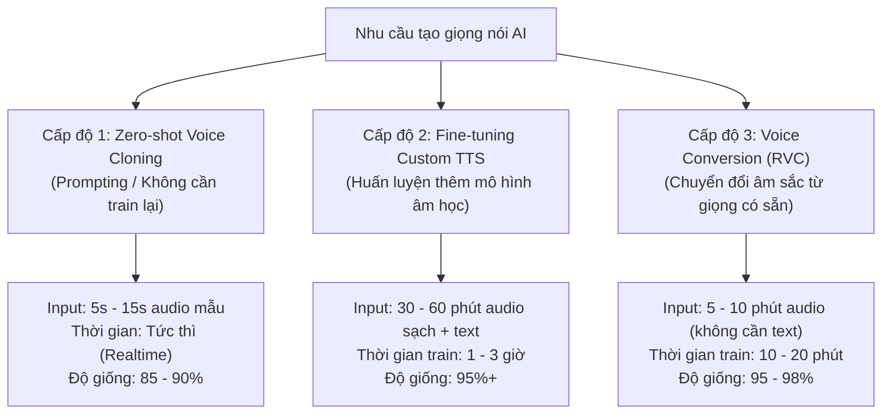
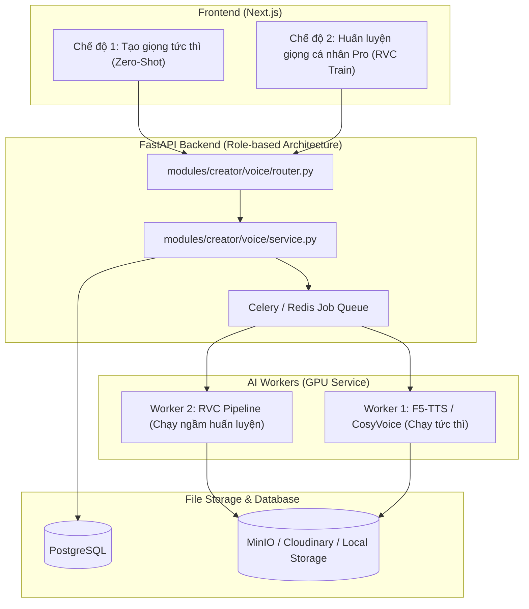

# PHÂN TÍCH TỔNG QUAN VÀ GIẢI PHÁP KỸ THUẬT: TRAINING AI TẠO GIỌNG NÓI (VOICE CLONING & TTS)
> **Dự án:** Video AI Automation Platform  
> **Module:** `ba/ba_create_giong_noi`  
> **Người lập:** Business Analyst & AI Solutions Architect  
> **Ngày lập:** 01/11/2026  
> **Mục tiêu:** Phân tích toàn diện các phương pháp, quy trình kỹ thuật, kiến trúc hệ thống và luồng nghiệp vụ để xây dựng tính năng tạo/huấn luyện giọng nói AI phục vụ làm video tự động.

---

## 📑 MỤC LỤC
1. [Tổng quan & Định nghĩa bài toán](#1-tổng-quan--định-nghĩa-bài-toán)
2. [Phân tích 3 phương pháp tiếp cận cốt lõi (Approaches)](#2-phân-tích-3-phương-pháp-tiếp-cận-cốt-lõi-approaches)
3. [Quy trình chi tiết để Huấn luyện AI Giọng nói (Pipeline End-to-End)](#3-quy-trình-chi-tiết-để-huấn-luyện-ai-giọng-nói-pipeline-end-to-end)
4. [So sánh các Model SOTA mã nguồn mở hàng đầu hiện nay](#4-so-sánh-các-model-sota-mã-nguồn-mở-hàng-đầu-hiện-nay)
5. [Đề xuất Giải pháp Kỹ thuật tối ưu cho Dự án Video AI](#5-đề-xuất-giải-pháp-kỹ-thuật-tối-ưu-cho-dự-án-video-ai)
6. [Thiết kế Luồng Nghiệp vụ (BA Specification) & CSDL](#6-thiết-kế-luồng-nghiệp-vụ-ba-specification--csdl)
7. [Yêu cầu Phần cứng & Chi phí vận hành](#7-yêu-cầu-phần-cứng--chi-phí-vận-hành)

---

## 1. TỔNG QUAN & ĐỊNH NGHĨA BÀI TOÁN

Trong hệ thống **Video AI**, giọng đọc (Voiceover / Narration) là linh hồn của video. Để cá nhân hóa và tự động hóa video ở mức cao nhất, người dùng cần có khả năng:
1. **Sử dụng giọng của chính mình** (Voice Clone) để video mang phong cách cá nhân mà không cần tự đọc từng video.
2. **Tạo ra nhiều nhân vật ảo** với các âm sắc đặc thù (già, trẻ, nam, nữ, vùng miền: Bắc - Trung - Nam, hoạt hình, kịch tính).
3. **Chuyển ngữ lồng tiếng (Dubbing):** Giữ nguyên giọng nói của diễn viên gốc nhưng nói bằng tiếng Việt (hoặc ngược lại).

### Bản chất kỹ thuật của giọng nói:
Giọng nói con người được cấu thành bởi 3 yếu tố chính:
- **Âm sắc (Timbre):** Màu giọng, độ trầm bổng do cấu tạo vòm họng và dây thanh quản tạo ra (yếu tố nhận diện giọng).
- **Ngữ điệu & Nhịp điệu (Prosody, Pitch & Rhythm):** Cách ngắt nghỉ, nhấn nhá, tốc độ nói, độ cao thấp theo cảm xúc.
- **Nội dung ngữ âm (Phonetics/Linguistics):** Các từ, nguyên âm, phụ âm phát ra theo ngữ pháp ngôn ngữ.

---

## 2. PHÂN TÍCH 3 PHƯƠNG PHÁP TIẾP CẬN CỐT LÕI (APPROACHES)

Khi làm sản phẩm phần mềm, việc "Training AI giọng nói" có 3 cấp độ với độ phức tạp và trải nghiệm người dùng hoàn toàn khác nhau:



### 2.1. Cấp độ 1: Zero-shot Voice Cloning (Sinh giọng tức thì qua Voice Prompt)
- **Cơ chế:** Mô hình nền tảng (Foundation Model) đã được huấn luyện trước trên hàng chục nghìn giờ nói. Khi nhận được một đoạn audio ngắn (3 – 10 giây) của người dùng, mô hình trích xuất vector đặc trưng giọng nói (**Speaker Embedding**) và điều phối (conditioning) bộ sinh âm thanh đọc văn bản mới theo đúng âm sắc đó.
- **Đại diện tiêu biểu:** **F5-TTS**, **CosyVoice 2**, **XTTS-v2**, **Fish-Speech**, **ChatTTS**.
- **Ưu điểm:**
  - Người dùng không phải chờ đợi hàng giờ để training.
  - Chỉ cần tải lên 1 đoạn thu âm 10 giây là có thể dùng ngay.
  - Tiết kiệm chi phí GPU máy chủ.
- **Nhược điểm:**
  - Đôi khi âm sắc chưa hoàn toàn ổn định qua các câu quá dài.
  - Phụ thuộc vào chất lượng hỗ trợ tiếng Việt của Foundation model.

### 2.2. Cấp độ 2: Fine-tuning Custom Model (Huấn luyện chuyên sâu)
- **Cơ chế:** Đóng băng các tầng trích xuất ngữ âm (Phoneme Encoder) của mô hình gốc (như VITS, StyleTTS2, FastSpeech2) và huấn luyện cập nhật trọng số (weights) của Decoder/Acoustic Model bằng tập dữ liệu riêng của người dùng.
- **Yêu cầu dữ liệu:** 30 đến 120 phút thu âm chất lượng phòng thu, kèm toàn bộ văn bản phụ đề tương ứng đã được căn chỉnh timestamp chính xác.
- **Ưu điểm:**
  - Chất lượng giọng cực kỳ ổn định, đọc mượt mà, không bị chập chờn âm sắc.
  - Kiểm soát được nhịp thở, ngắt nghỉ theo phong cách người đọc.
- **Nhược điểm:**
  - Quy trình chuẩn bị dữ liệu rất phức tạp (cần text khớp 100% với audio).
  - Tốn tài nguyên GPU (thời gian train mất từ 1 - 4 giờ trên GPU mạnh).

### 2.3. Cấp độ 3: Voice Conversion (RVC - Retrieval-based Voice Conversion)
- **Cơ chế:** Tách biệt hoàn toàn việc "đọc văn bản" và việc "đổi màu giọng":
  - Bước 1: Dùng một bộ TTS chuẩn (như Edge-TTS hoặc GPT-SoVITS) để đọc kịch bản ra giọng chuẩn, rõ chữ, nhịp điệu hoàn hảo.
  - Bước 2: Đưa file âm thanh đó qua model RVC. RVC sẽ trích xuất cao độ (F0) và hoán đổi âm sắc gốc sang âm sắc của nhân vật mục tiêu.
- **Đại diện tiêu biểu:** **RVC v2 (Retrieval-based Voice Conversion)**.
- **Ưu điểm vượt trội:**
  - **Không cần Text Transcript khi train:** Người dùng chỉ cần gửi 5-10 phút audio nói chuyện bình thường, không cần gõ chữ.
  - **Thời gian train siêu nhanh:** Chỉ mất 10 - 15 phút trên GPU RTX 3060/4090.
  - **Độ giống người thật lên tới 98%**, giữ được toàn bộ cảm xúc, tiếng cười, tiếng thở của giọng đọc gốc.
- **Nhược điểm:** Quy trình inference cần 2 bước (TTS $\rightarrow$ RVC).

---

## 3. QUY TRÌNH CHI TIẾT ĐỂ HUẤN LUYỆN AI GIỌNG NÓI (PIPELINE END-TO-END)

Dưới đây là pipeline kỹ thuật chuẩn áp dụng cho việc xây dựng tính năng Voice Training tự động trong sản phẩm:

```
[Audio thô người dùng tải lên]
          │
          ▼
   1. TIỀN XỬ LÝ (PREPROCESSING)
   ├── Tách nhạc nền & tạp âm (UVR5 / Demucs v4)
   ├── Cắt đoạn thông minh (Audio Slicer: 3s - 10s)
   ├── Chuẩn hóa âm lượng (LUFS: -16dB)
   └── (Nếu là TTS): Tự động gán nhãn văn bản (Whisper ASR)
          │
          ▼
   2. TRÍCH XUẤT ĐẶC TRƯNG (FEATURE EXTRACTION)
   ├── Trích xuất cao độ F0 (RMVPE / Crepe)
   ├── Trích xuất biểu diễn âm thanh (ContentVec / HuBERT / DAC)
   └── Trích xuất chỉ số tìm kiếm (Feature Indexing - Faiss)
          │
          ▼
   3. HUẤN LUYỆN MÔ HÌNH (MODEL TRAINING)
   ├── Khởi tạo Generator & Discriminator
   ├── Huấn luyện qua các Epochs (Loss Mel, Loss F0, Loss Adv)
   └── Lưu Checkpoint (.pth / .onnx)
          │
          ▼
   4. ĐÁNH GIÁ & ĐÓNG GÓI (EVALUATION & PACKAGING)
   ├── Sinh mẫu thử nghiệm tự động
   ├── Tính điểm Speaker Similarity (Cosine Metric)
   └── Export Weights vào thư mục Storage của User
```

### Bước 1: Tiền xử lý dữ liệu tự động (Preprocessing Pipeline)
1. **Lọc tạp âm và nhạc nền (Vocal Isolation):** Sử dụng model **UVR5 (MDX-Net / Demucs v4)** để bóc tách 100% tiếng nhạc, tiếng rè, tiếng vang trong phòng, chỉ giữ lại "Dry Vocal" (giọng mộc).
2. **Cắt nhỏ âm thanh (Silence-based Audio Slicing):**
   - Các mô hình AI học âm thanh tốt nhất ở các phân đoạn từ **3 giây đến 10 giây**.
   - Dùng thuật toán phát hiện khoảng lặng (VAD - Voice Activity Detection / Silero VAD) để cắt tại các vị trí người nói ngắt câu tự nhiên.
3. **Chuẩn hóa âm lượng (Loudness Normalization):** Đưa toàn bộ các đoạn cắt về chuẩn **-16 LUFS** hoặc RMS target để tránh hiện tượng câu to câu nhỏ.

### Bước 2: Trích xuất đặc trưng âm học (Feature Extraction)
1. **Trích xuất cao độ (Pitch / F0):**
   - Rất quan trọng đối với ngôn ngữ thanh điệu như **Tiếng Việt** (6 thanh: ngang, huyền, sắc, hỏi, ngã, nặng).
   - Sử dụng thuật toán **RMVPE (Robust Model for Vocal Pitch Estimation)** - thuật toán tốt nhất hiện nay, vượt trội hoàn toàn so với Harvest hay PM cũ.
2. **Trích xuất ngữ nghĩa âm thanh (Acoustic Content):**
   - Dùng **HuBERT-Soft** hoặc **ContentVec** (768 dimensions) để mã hóa nội dung phát âm mà không phụ thuộc vào người nói.
3. **Xây dựng Faiss Index (Feature Retrieval):**
   - Trích xuất toàn bộ vector đặc trưng của người nói và lưu vào thư viện tìm kiếm vector Faiss (`.index`).
   - Trong quá trình đọc sau này, thuật toán sẽ tìm kiếm các vector âm sắc gần nhất trong file `.index` để bù trừ, giúp giọng đọc không bị "giả" hoặc vỡ tiếng.

### Bước 3: Quá trình Huấn luyện (Training Process)
1. **Thiết lập tham số kỹ thuật (Hyperparameters):**
   - **Sample Rate:** `40kHz` hoặc `48kHz` (cho chất lượng âm thanh cao cấp).
   - **Target Epochs:** 150 - 300 epochs (tương đương khoảng 10.000 - 20.000 steps).
   - **Batch Size:** 8 đến 16 (tùy thuộc vào VRAM GPU, 8GB VRAM dùng batch size 4-8, 16GB-24GB dùng batch size 16).
   - **Optimizer:** AdamW với Learning Rate Scheduler (giảm dần theo cosine decay).
2. **Các hàm mất mát (Loss Functions):**
   - **Mel-spectrogram Loss:** Đo lường độ sai lệch giữa âm phổ thực tế và âm phổ do AI sinh ra.
   - **F0 Loss:** Đảm bảo AI phát âm chuẩn cao độ của dấu tiếng Việt.
   - **Adversarial GAN Loss:** Tăng độ sắc nét và tính tự nhiên của giọng, triệt tiêu tiếng robot.

---

## 4. SO SÁNH CÁC MODEL SOTA MÃ NGUỒN MỞ HÀNG ĐẦU HIỆN NAY

| Mô hình | Loại hình | Yêu cầu Audio đầu vào | Thời gian sẵn sàng | Chất lượng Tiếng Việt | Ưu thế lớn nhất |
| :--- | :--- | :--- | :--- | :--- | :--- |
| **RVC v2** | Voice Conversion | 5 – 10 phút | 10 – 15 phút train | ⭐⭐⭐⭐⭐ (9.5/10) | Giọng cực kỳ tự nhiên, giữ nguyên cảm xúc, train rất nhanh, không cần gõ chữ. |
| **F5-TTS** | Zero-shot TTS (Flow-Matching) | 5 – 10 giây | Tức thì (Realtime) | ⭐⭐⭐⭐☆ (8.5/10) | Kiến trúc Flow-Matching hiện đại, không bị lặp từ như transformer, clone giọng cực nhanh. |
| **CosyVoice 2** | Multi-lingual TTS (Alibaba) | 3 – 5 giây | Tức thì (Realtime) | ⭐⭐⭐⭐☆ (8.0/10) | Hỗ trợ đa ngôn ngữ, độ trễ cực thấp (phù hợp streaming), clone nhanh. |
| **GPT-SoVITS** | Few-shot TTS | 5 giây + 1 phút fine-tune | 3 – 5 phút train | ⭐⭐⭐⭐⭐ (9.0/10) | Kết hợp cross-lingual, đọc câu ngắn cực kỳ giống giọng gốc. |
| **Edge-TTS** | Pre-trained TTS (Microsoft) | Có sẵn (không clone) | Tức thì (0đ) | ⭐⭐⭐⭐☆ (8.5/10) | Miễn phí, ổn định cao, phát âm tiếng Việt chuẩn từng từ (Hoài My, Nam Minh). |

---

## 5. ĐỀ XUẤT GIẢI PHÁP KỸ THUẬT TỐI ƯU CHO DỰ ÁN VIDEO AI

Để cân bằng giữa **Chất lượng đỉnh cao**, **Trải nghiệm người dùng mượt mà** và **Chi phí máy chủ tối ưu**, đề xuất kiến trúc kết hợp **Hybrid Voice Engine** gồm 2 luồng:



### 🎯 Chiến lược triển khai 2 chế độ (Feature Modes):

#### Chế độ A: "Tạo Giọng Nhanh" (Instant Voice Clone - Dành cho người dùng phổ thông)
- **Công nghệ:** **F5-TTS** hoặc **CosyVoice 2**.
- **Cách dùng:** Người dùng đọc 1 câu mẫu 10 giây trên trình duyệt (hoặc tải file ghi âm ngắn).
- **Kết quả:** Có ngay giọng đọc trong vòng **3 giây**, dùng trực tiếp để tạo thuyết minh cho video.

#### Chế độ B: "Phòng Thu AI Cá Nhân" (Pro Voice Studio - Dành cho KOC, Creator chuyên nghiệp)
- **Công nghệ:** **RVC v2 + Edge-TTS**.
- **Cách dùng:**
  1. Người dùng tải lên 5 - 10 phút audio (podcast, video tiktok cũ, hoặc file ghi âm giọng nói).
  2. Hệ thống đẩy vào Background Worker: UVR5 lọc tạp âm $\rightarrow$ Cắt đoạn $\rightarrow$ Train RVC trong 10-15 phút.
  3. Khi hoàn tất, hệ thống thông báo qua WebSocket/Email: "Giọng AI của bạn đã sẵn sàng!".
- **Cơ chế phát âm khi tạo video:**
  - Nhập văn bản kịch bản $\longrightarrow$ `Edge-TTS` đọc nháp thành tiếng Việt chuẩn $\longrightarrow$ Model RVC của user biến đổi thành giọng của user với độ giống **98%**.

---

## 6. THIẾT KẾ LUỒNG NGHIỆP VỤ (BA SPECIFICATION) & CSDL

### 6.1. Bảng thiết kế Database Schema (PostgreSQL)

```sql
-- 1. Bảng hồ sơ giọng nói (Voice Profiles)
CREATE TABLE voice_profiles (
    id UUID PRIMARY KEY DEFAULT gen_random_uuid(),
    user_id UUID NOT NULL,
    name VARCHAR(100) NOT NULL,
    avatar_url VARCHAR(255),
    type VARCHAR(20) NOT NULL, -- 'PRESET', 'INSTANT_CLONE', 'TRAINED_RVC'
    gender VARCHAR(10) DEFAULT 'unisex', -- 'male', 'female', 'other'
    sample_audio_url VARCHAR(255),
    is_active BOOLEAN DEFAULT true,
    created_at TIMESTAMP WITH TIME ZONE DEFAULT NOW(),
    updated_at TIMESTAMP WITH TIME ZONE DEFAULT NOW()
);

-- 2. Bảng mô hình đã huấn luyện (Voice Models Artifacts)
CREATE TABLE voice_model_artifacts (
    id UUID PRIMARY KEY DEFAULT gen_random_uuid(),
    voice_profile_id UUID NOT NULL REFERENCES voice_profiles(id) ON DELETE CASCADE,
    model_weight_path VARCHAR(255) NOT NULL, -- Đường dẫn file .pth
    index_file_path VARCHAR(255),            -- Đường dẫn file .index (Faiss)
    total_training_audio_seconds INT,
    epochs_trained INT DEFAULT 200,
    similarity_score FLOAT,
    created_at TIMESTAMP WITH TIME ZONE DEFAULT NOW()
);

-- 3. Bảng tiến trình huấn luyện (Voice Training Jobs)
CREATE TABLE voice_training_jobs (
    id UUID PRIMARY KEY DEFAULT gen_random_uuid(),
    user_id UUID NOT NULL,
    voice_profile_id UUID REFERENCES voice_profiles(id),
    status VARCHAR(30) NOT NULL, -- 'QUEUED', 'PREPROCESSING', 'TRAINING', 'COMPLETED', 'FAILED'
    progress_percent INT DEFAULT 0,
    current_epoch INT DEFAULT 0,
    total_epochs INT DEFAULT 200,
    error_message TEXT,
    started_at TIMESTAMP WITH TIME ZONE,
    finished_at TIMESTAMP WITH TIME ZONE
);
```

### 6.2. Thiết kế API Endpoints theo chuẩn Python Backend Architecture

Tuân thủ nghiêm ngặt quy tắc tại [python-backend-architecture](file:///d:/DuAnCaNhan/video_ai/.agents/skills/python-backend-architecture/SKILL.md), các endpoint được đặt tại:
`app/modules/creator/voice/router.py`

| Method | Endpoint | Mô tả |
| :--- | :--- | :--- |
| `GET` | `/api/v1/creator/voices` | Lấy danh sách giọng có sẵn (Presets) và giọng của User |
| `POST` | `/api/v1/creator/voices/instant` | Tạo profile giọng clone tức thì (Zero-shot) từ file mẫu 10s |
| `POST` | `/api/v1/creator/voices/train` | Khởi tạo job huấn luyện giọng RVC (Upload tập audio) |
| `GET` | `/api/v1/creator/voices/train/{job_id}/status` | Kiểm tra tiến độ training (%) |
| `POST` | `/api/v1/creator/voices/synthesize` | Chuyển văn bản thành giọng nói (Text-to-Speech) |
| `WS` | `/ws/creator/voices/train/{job_id}` | WebSocket nhận realtime log epoch và % tiến độ |

---

## 7. YÊU CẦU PHẦN CỨNG & CHI PHÍ VẬN HÀNH

### 7.1. Cấu hình máy tính / Server khuyến nghị:
1. **Môi trường phát triển & Thử nghiệm (Local Dev):**
   - **GPU:** NVIDIA RTX 3060 (12GB VRAM) hoặc RTX 4060 Ti (16GB VRAM) trở lên (CUDA core bắt buộc).
   - **RAM:** Tối thiểu 16GB (khuyến nghị 32GB để xử lý audio cache).
   - **Ổ cứng:** SSD NVMe (Tốc độ đọc/ghi dữ liệu audio rất cao khi train).
2. **Môi trường Cloud Production (Server chuyên dụng):**
   - **GPU Cloud:** Thuê instance RTX 4090 (24GB VRAM) hoặc A10G trên RunPod / Vast.ai / Lambda Labs (chi phí khoảng **\$0.30 - \$0.60 / giờ**).
   - Cơ chế **Auto-scaling / Serverless GPU**: Chỉ bật GPU Worker khi có user bấm "Huấn luyện giọng", train xong 15 phút tự động tắt máy để tiết kiệm 100% chi phí nhàn rỗi.

---

## 💡 KẾT LUẬN & BƯỚC ĐI TIẾP THEO CHO DỰ ÁN

1. **Giai đoạn 1 (MVP Nhanh):**
   - Tích hợp **Edge-TTS** (có sẵn 0đ) làm giọng chuẩn.
   - Thêm tính năng **Zero-shot Voice Clone** (dùng F5-TTS) để người dùng thử nghiệm tạo giọng ngay lập tức.
2. **Giai đoạn 2 (Pro Features):**
   - Xây dựng Pipeline **RVC v2 Training Worker** chạy ngầm bằng Celery + GPU worker để hỗ trợ tính năng clone giọng độ chân thực cao 98%.
   - Cho phép người dùng lưu trữ "Voice Library" cá nhân để dùng chung cho mọi kịch bản video tiếp theo.

