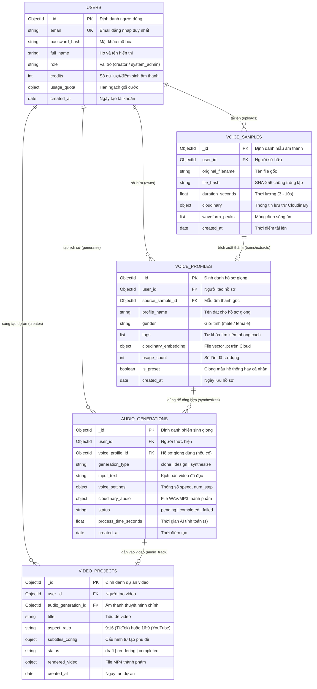

# TỔNG QUAN KIẾN TRÚC CƠ SỞ DỮ LIỆU (DATABASE ARCHITECTURE SPECIFICATION)
## Dự án: Nền Tảng Tự Động Hóa Video AI (Video AI Automation Platform)
### Phiên bản: 1.0.0 | Hệ thống CSDL: MongoDB (NoSQL) & Cloudinary (Object Storage/CDN)

---

## 📌 1. BỐI CẢNH & MỤC TIÊU HỆ THỐNG

Nền tảng **Video AI Platform** là hệ thống all-in-one phục vụ các Content Creator, Marketer và Video Editor trong việc tự động hóa quy trình sản xuất nội dung video:
1. **Lồng tiếng AI & Nhái giọng (Voice Cloning & TTS):** Nhái giọng người thật từ 3–10s âm thanh mẫu, thiết kế giọng mới bằng câu lệnh chữ, hoặc tổng hợp kịch bản dài bằng hồ sơ giọng đã lưu.
2. **Kho giọng nói cá nhân hóa (Voice Profiles):** Lưu trữ và tái sử dụng vĩnh viễn các đặc trưng giọng nói (file `.pt` embedding vector) cho từng kênh/thương hiệu.
3. **Ghép nối và dựng video tự động (Video Generator & Subtitles):** Tự động đồng bộ hóa âm thanh với hình ảnh, video nền và phụ đề động.

### Mô hình lưu trữ lai (Hybrid Storage Model):
* **MongoDB (Document Database):** Lưu trữ toàn bộ dữ liệu có cấu trúc linh hoạt (Users, Profiles, Lịch sử sinh giọng, Kịch bản, Metadata, Project timeline). Cho phép truy vấn siêu tốc, dễ mở rộng khi thêm các tính năng video/subtitles mới mà không cần migration phức tạp.
* **Cloudinary (Media & Asset Storage / Audio CDN):** Lưu trữ toàn bộ dữ liệu file nhị phân dung lượng lớn:
  - File ghi âm mẫu (`.mp3`, `.wav`)
  - File âm thanh thành phẩm do AI sinh ra (`.wav`, `.mp3`)
  - File vector nhúng giọng nói của PyTorch (`.pt`)
  - Video thành phẩm xuất bản (`.mp4`)

---

## 🏛️ 2. SƠ ĐỒ THỰC THỂ QUAN HỆ TỔNG THỂ (ERD)

---

## 📁 3. DANH MỤC TÀI LIỆU CHI TIẾT CÁC BẢNG (COLLECTIONS)

Mỗi file trong thư mục này giải thích chi tiết cấu trúc, ý nghĩa nghiệp vụ, ràng buộc dữ liệu và mẫu JSON thực tế của từng thực thể:

1. 📄 **[01_TABLE_USERS.md](file:///d:/DuAnCaNhan/video_ai/ba/database/01_TABLE_USERS.md)**:
   - Mô tả thông tin định danh, bảo mật mật khẩu, gói cước Creator/Pro, số dư điểm credits và hạn ngạch sinh audio hàng tháng.
2. 📄 **[02_TABLE_VOICE_SAMPLES.md](file:///d:/DuAnCaNhan/video_ai/ba/database/02_TABLE_VOICE_SAMPLES.md)**:
   - Mô tả các đoạn thu âm mẫu 3–10s, cơ chế băm file chống upload trùng lặp, sóng âm waveform peaks và ánh xạ lưu trữ Cloudinary Video Asset.
3. 📄 **[03_TABLE_VOICE_PROFILES.md](file:///d:/DuAnCaNhan/video_ai/ba/database/03_TABLE_VOICE_PROFILES.md)**:
   - Mô tả hồ sơ kiểu giọng đã training/trích xuất embedding vector (`.pt`), các nhãn phân loại (giới tính, vùng miền, phong cách) để dùng lâu dài cho Tab 3.
4. 📄 **[04_TABLE_AUDIO_GENERATIONS.md](file:///d:/DuAnCaNhan/video_ai/ba/database/04_TABLE_AUDIO_GENERATIONS.md)**:
   - Mô tả nhật ký chi tiết các lần sinh giọng nói (Zero-shot Clone, Voice Design, Profile Synthesize), lưu kịch bản, thời gian sinh và file âm thanh phát trực tuyến.
5. 📄 **[05_TABLE_VIDEO_PROJECTS.md](file:///d:/DuAnCaNhan/video_ai/ba/database/05_TABLE_VIDEO_PROJECTS.md)**:
   - Mô tả dự án dựng video hoàn chỉnh, liên kết âm thanh lồng tiếng với timeline hình ảnh, hiệu ứng chữ và tự động hóa phụ đề (Subtitles).
6. 📄 **[06_INDEX_AND_RELATIONSHIPS.md](file:///d:/DuAnCaNhan/video_ai/ba/database/06_INDEX_AND_RELATIONSHIPS.md)**:
   - Toàn cảnh chiến lược Indexing trong MongoDB (Compound Index, Text Search Index), giải pháp bảo toàn tính toàn vẹn dữ liệu và tối ưu thời gian truy vấn $< 10\text{ms}$.

